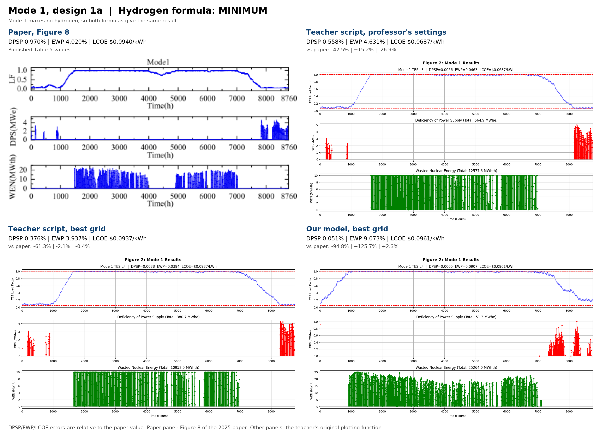
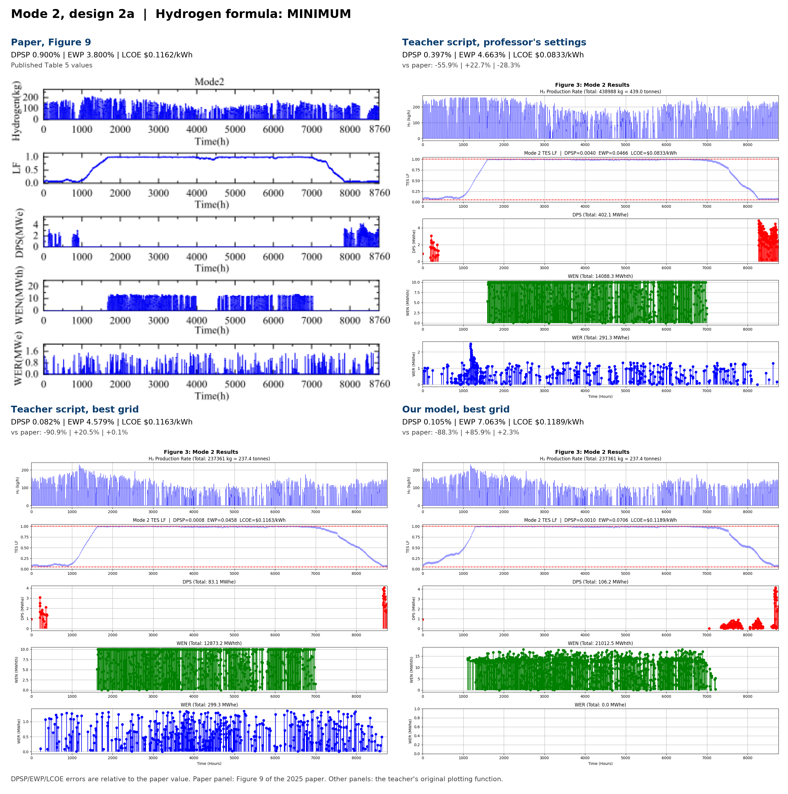
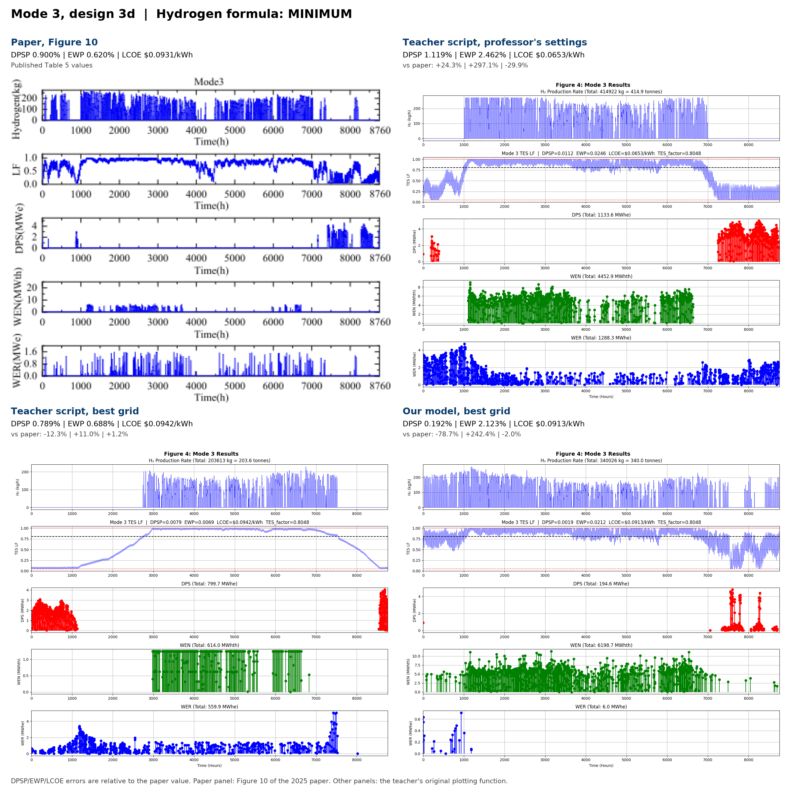
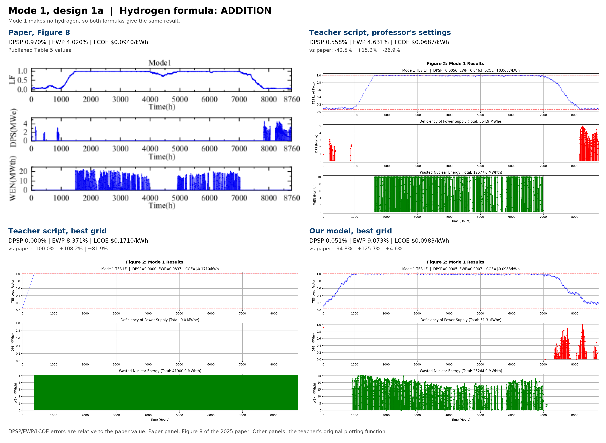
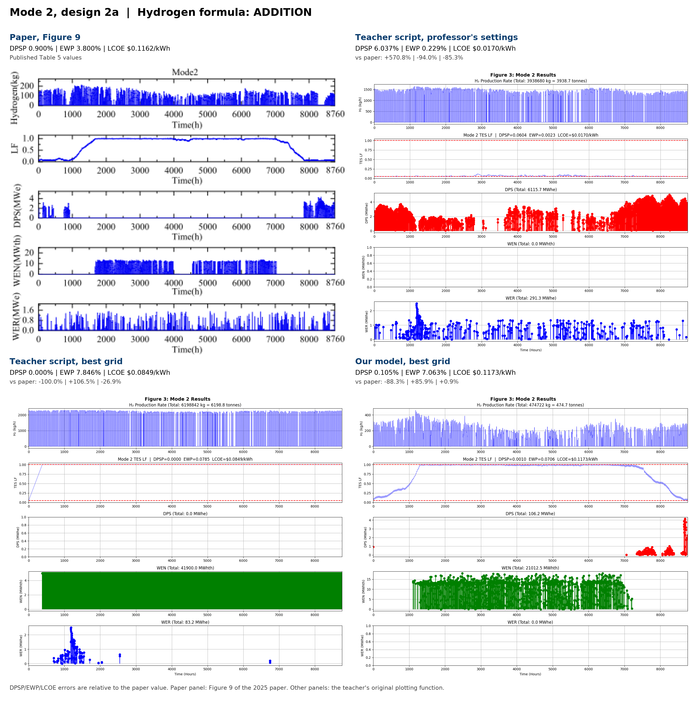
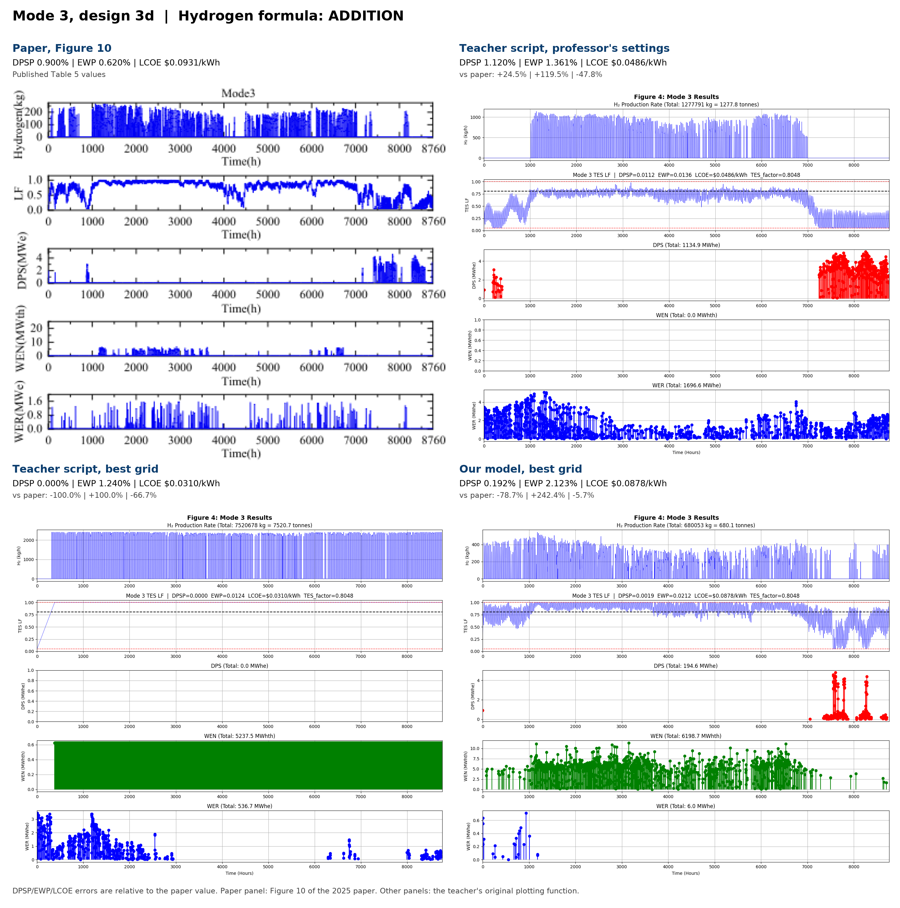

# Teacher designs 1a / 2a / 3d: teacher script vs our model, minimum vs addition

Only the three designs the professor's script runs: Mode 1 solution 1 (1a), Mode 2 solution 1 (2a), Mode 3 solution 4 (3d).
**Excel values and order, PV/WT/TES/SOEC capacities, DF, TES factor, efficiencies and unit prices are fixed.**
Only the settings changed in earlier work are searched (TES power limits and scaling, PV interpretation, reactor power, SOEC-off allocation, Mode 3 switch check, and six finance conventions).

Each engine/formula pair tests the full product of 1600 physical x 240 financial settings = **384,000 configurations** (1,536,000 in total).
Selection: lowest worst relative error + 0.1 x RMS relative error over the nine paper entries. One shared setting applies to all three designs.

## Formulas

- **Minimum** (paper p5 text, teacher code): H2 = min(K_e x P_e, K_th x P_th).
- **Addition** (paper Eq. 9): H2 = K_e x P_e + K_th x P_th.
- Teacher script, addition: the teacher's line `min(...)` becomes a sum, and the electricity and heat it sends to the SOEC are consumed. The teacher's own heat rule sends up to P_SOEC/0.4 MWth.
- Our model, addition: heat is sent in the SOEC's heat-to-electricity requirement ratio (11.15/35.1), limited by heat available, so the energy balance closes. With enough heat this doubles hydrogen compared with minimum.
- Mode 1 has no hydrogen production, so its results do not depend on the formula.

## Results table

DPSP and EWP in %, LCOE in $/kWh. Brackets: relative error versus the paper. The paper has one value per entry; it is repeated for both formulas.
'Teacher original' is the professor's script at the professor's settings (minimum = unchanged original run; addition = only the formula switched).

| Mode | Metric | Formula | Paper | Teacher original | Teacher script, best grid | Our model, best grid |
|---|---|---|---:|---:|---:|---:|
| 1 (1a) | DPSP (%) | Minimum | 0.9700 | 0.5577 (-42.5%) | 0.3758 (-61.3%) | 0.0507 (-94.8%) |
| 1 (1a) | DPSP (%) | Addition | 0.9700 | 0.5577 (-42.5%) | 0.0000 (-100.0%) | 0.0507 (-94.8%) |
| 1 (1a) | EWP (%) | Minimum | 4.0200 | 4.6315 (+15.2%) | 3.9374 (-2.1%) | 9.0732 (+125.7%) |
| 1 (1a) | EWP (%) | Addition | 4.0200 | 4.6315 (+15.2%) | 8.3706 (+108.2%) | 9.0732 (+125.7%) |
| 1 (1a) | LCOE ($/kWh) | Minimum | 0.094012 | 0.068688 (-26.9%) | 0.093663 (-0.4%) | 0.096131 (+2.3%) |
| 1 (1a) | LCOE ($/kWh) | Addition | 0.094012 | 0.068688 (-26.9%) | 0.171048 (+81.9%) | 0.098324 (+4.6%) |
| 2 (2a) | DPSP (%) | Minimum | 0.9000 | 0.3969 (-55.9%) | 0.0820 (-90.9%) | 0.1049 (-88.3%) |
| 2 (2a) | DPSP (%) | Addition | 0.9000 | 6.0368 (+570.8%) | 0.0000 (-100.0%) | 0.1049 (-88.3%) |
| 2 (2a) | EWP (%) | Minimum | 3.8000 | 4.6635 (+22.7%) | 4.5788 (+20.5%) | 7.0633 (+85.9%) |
| 2 (2a) | EWP (%) | Addition | 3.8000 | 0.2292 (-94.0%) | 7.8455 (+106.5%) | 7.0633 (+85.9%) |
| 2 (2a) | LCOE ($/kWh) | Minimum | 0.116200 | 0.083285 (-28.3%) | 0.116315 (+0.1%) | 0.118869 (+2.3%) |
| 2 (2a) | LCOE ($/kWh) | Addition | 0.116200 | 0.017037 (-85.3%) | 0.084890 (-26.9%) | 0.117267 (+0.9%) |
| 3 (3d) | DPSP (%) | Minimum | 0.9000 | 1.1190 (+24.3%) | 0.7894 (-12.3%) | 0.1921 (-78.7%) |
| 3 (3d) | DPSP (%) | Addition | 0.9000 | 1.1203 (+24.5%) | 0.0000 (-100.0%) | 0.1921 (-78.7%) |
| 3 (3d) | EWP (%) | Minimum | 0.6200 | 2.4618 (+297.1%) | 0.6879 (+11.0%) | 2.1227 (+242.4%) |
| 3 (3d) | EWP (%) | Addition | 0.6200 | 1.3607 (+119.5%) | 1.2397 (+100.0%) | 2.1227 (+242.4%) |
| 3 (3d) | LCOE ($/kWh) | Minimum | 0.093100 | 0.065267 (-29.9%) | 0.094231 (+1.2%) | 0.091261 (-2.0%) |
| 3 (3d) | LCOE ($/kWh) | Addition | 0.093100 | 0.048574 (-47.8%) | 0.030961 (-66.7%) | 0.087837 (-5.7%) |

## Summary of each column

| Column | Formula | Worst relative error | RMS relative error | Entries within 10% | Designs with all three within 10% |
|---|---|---:|---:|---:|---:|
| teacher_original | Minimum | 297.07% | 103.79% | 0/9 | 0/3 |
| teacher_original | Addition | 570.75% | 200.50% | 0/9 | 0/3 |
| teacher_grid_best | Minimum | 90.89% | 37.58% | 4/9 | 0/3 |
| teacher_grid_best | Addition | 108.22% | 91.25% | 0/9 | 0/3 |
| our_grid_best | Minimum | 242.37% | 107.96% | 3/9 | 0/3 |
| our_grid_best | Addition | 242.37% | 107.98% | 3/9 | 0/3 |

## Best settings

| Setting | Teacher script, Minimum | Teacher script, Addition | Our model, Minimum | Our model, Addition |
|---|---|---|---|---|
| tes_charge_mwth | 10 | 5 | 25 | 25 |
| tes_discharge_mwth | 7.5 | 5 | 10 | 10 |
| tes_rating | both_scaled | charge_scaled | absolute | absolute |
| pv_model | nameplate_150W | area_efficiency | nameplate_150W | nameplate_150W |
| reactor_2025_mwth | 25 | 50 | 25 | 25 |
| inactive_soec | keep_split | renewables_first | renewables_first | renewables_first |
| soc_switch | start | start | start | start |
| real_rate | 6.000% | 10.000% | 8.000% | 8.000% |
| years | 20 | 20 | 40 | 20 |
| variable_basis | thermal | thermal | thermal | electric |
| load_basis | requested | served | served | served |
| balance_of_plant | separate_rated_proxy | separate_rated_proxy | separate_rated_proxy | separate_rated_proxy |
| decommissioning | project | project | retirement | retirement |
| configuration ID | TM-P0441-F056 | TA-P0023-F148 | OM-P1099-F131 | OA-P1099-F107 |

Professor's settings: TES 10/10 MWth absolute, PV area/efficiency, 25 MWth, keep split, start-of-hour check, 3.92% real, 20 y, thermal variable cost, served load, embedded BOP, retirement decommissioning. They are inside the grid.
The separate balance-of-plant option is an unverified sizing proxy and may double-count costs.
The teacher-script engine keeps the teacher's own accounting (including its known issues); only our model is conservation-audited.

## Plots

Each image: paper figure (top left), teacher script at professor's settings (top right), teacher script best grid (bottom left), our model best grid (bottom right). All non-paper panels are drawn by the teacher's original `plot_figures`.

### Mode1, minimum

### Mode2, minimum

### Mode3, minimum

### Mode1, addition

### Mode2, addition

### Mode3, addition

## Files

- `comparison_table.csv` full-precision table; `summary.csv` column summaries.
- `<engine>/<formula>/ranking.csv.gz` every configuration; `top_1000_with_settings.csv`; `best/` settings, results, hourly arrays and teacher-style figures.
- `physical_settings.csv`, `finance_settings.csv` decode `physical_id`/`finance_id`.
- `teacher_original/` fresh unmodified teacher run. `teacher_script/addition/professor_settings/` same settings, addition formula.
- `teacher_engine_patches.txt` every edit applied to the teacher script.
