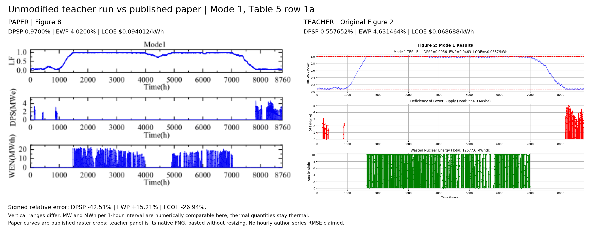
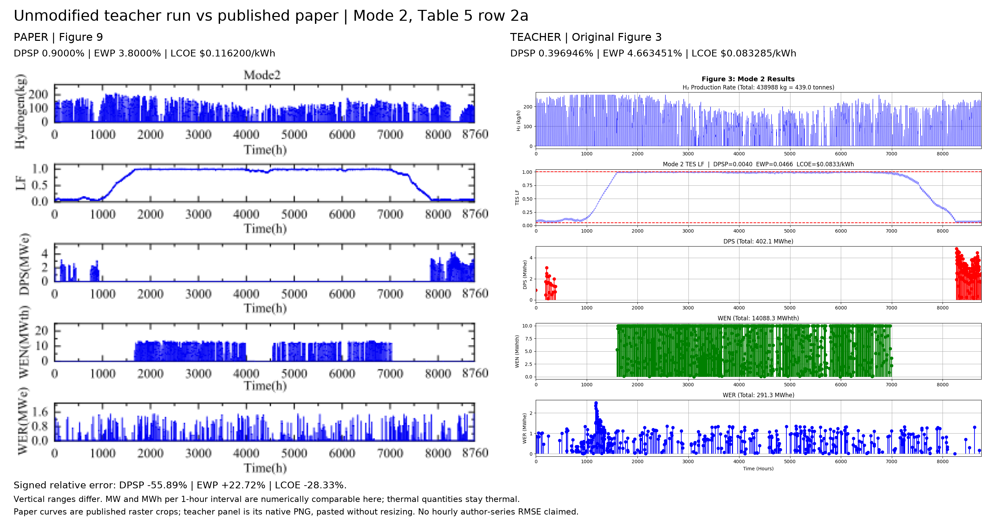
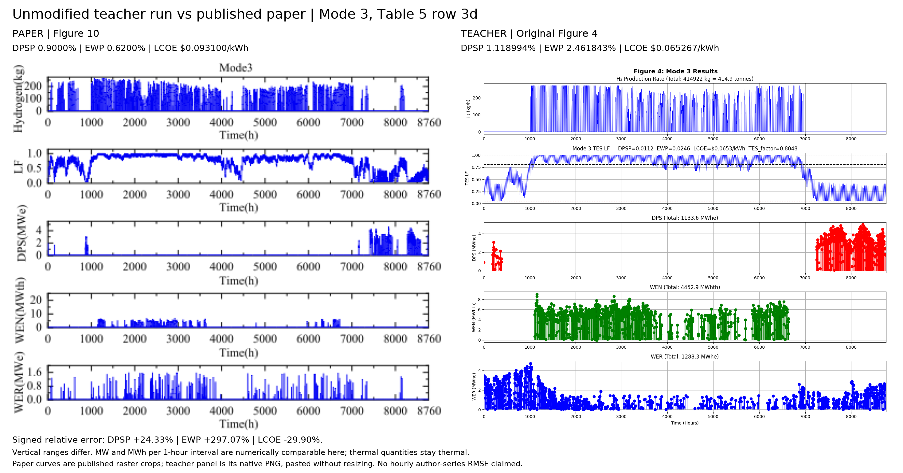

# Fresh unmodified teacher baseline vs 2025 paper

Run: 10 November 2026. Source: `NRHES_Model.py`, original `__main__` executed through `runpy.run_path`, including the original plot and CSV functions.

## Outcome

**None of the 9 matched DPSP/EWP/LCOE entries is within 5% or 10% relative error. None of these 3 rows passes.** This is not an evaluation of all 10 Table 5 rows.

The literal teacher main selects the first Mode 1 row (1a), first Mode 2 row (2a), and last Mode 3 row (3d). These match paper Figures 8, 9, and 10. Row letters are our labels, not labels printed in the paper.

## Table 5 comparison

DPSP and EWP below are fractions, as in the original Table 5. Multiply by 100 to express them as percentages. LCOE is USD/kWh.

Signed relative error = `100 * (teacher / paper - 1)`. Negative means below the paper value; it does not mean a successful reproduction.

| Mode / Table 5 row | Metric | Paper | Teacher | Relative error |
|---|---|---:|---:|---:|
| 1 / 1a | DPSP | 0.009700000 | 0.005576525 | -42.51% |
| 1 / 1a | EWP | 0.040200000 | 0.046314636 | +15.21% |
| 1 / 1a | LCOE | 0.094012000 | 0.068688015 | -26.94% |
| 2 / 2a | DPSP | 0.009000000 | 0.003969458 | -55.89% |
| 2 / 2a | EWP | 0.038000000 | 0.046634511 | +22.72% |
| 2 / 2a | LCOE | 0.116200000 | 0.083285452 | -28.33% |
| 3 / 3d | DPSP | 0.009000000 | 0.011189944 | +24.33% |
| 3 / 3d | EWP | 0.006200000 | 0.024618425 | +297.07% |
| 3 / 3d | LCOE | 0.093100000 | 0.065266517 | -29.90% |

The targets and capacities were checked against Table 5 on page 12 of the original 2025 paper, not just the teacher console. In particular, Mode 1 LCOE is 0.094012, not the console's rounded 0.0940.

## Actual paper vs actual teacher-generated plots

Paper on the left, original teacher PNG on the right. The teacher panels are pasted without resizing and were verified pixel-for-pixel. Published paper crops are resized only to fit the layout. No new simulation, fitted settings, curve scaling, smoothing or reconstructed author data was used.

Vertical axis ranges differ and must be read explicitly. The paper labels power in MW_e / MW_th, while the teacher labels the corresponding one-hour interval energies in MWh_e / MWh_th. With a one-hour interval these are numerically comparable. Nuclear waste remains thermal in both graph panels; no factor of 0.4 was applied to the plotted WEN.

### Visible and numerical differences

- The paper text on page 12 states LF near hour 4450 is about 0.71 in Mode 1 and 0.88 in Mode 2. The teacher's minimum LF during hours 4350–4550 is 0.969830 and 0.970191, respectively.
- Paper Figure 10 shows a much deeper midyear TES dip than the teacher's Mode 3 minimum 0.761505 in that window. It also shows hydrogen activity after hour 7000; the teacher's last positive Mode 3 hydrogen hour is 6993.
- Paper page 12 states Mode 1 renewable generation is always below demand and no renewable energy is wasted. In the teacher run, renewable power exceeds demand in 504 hours and Mode 1 renewable waste totals 414.465178 MWh_e. Neither native Mode 1 figure includes a WER panel, so this difference is verified from the teacher arrays and CSV.
- Teacher Mode 3 DPSP is 1.118994%, above the paper's less-than-1% selection condition.

These observations compare real outputs, not an exact curve fit. Full original author hourly arrays are unavailable, so no pointwise graph RMSE is claimed.

## Teacher hydrogen output

| Teacher mode | Annual hydrogen (tonnes) | Last producing hour |
|---|---:|---:|
| 1 | 0.000000 | Not applicable |
| 2 | 438.988009 | 8745 |
| 3 | 414.922341 | 6993 |

The teacher console prints 138.0 and 98.8 tonnes as “Paper Table 5 targets”. **Table 5 has no annual hydrogen column, so those console claims are not treated as verified published benchmarks.**

## Verification and limitations

- Original Python, MATLAB, Excel, and 2025 paper hashes are unchanged.
- The exact 8760 hourly input rows and values used by the teacher match the supplied Excel; no rescaling, shifting, reordering or substitutions.
- All three native metric rows agree exactly with the results returned by the teacher main.
- Hourly exported arrays are finite, 8760 values per series; their hydrogen totals agree with the native CSV.
- The preserved paper page PDFs have the same extracted text as original paper pages 12–14.
- This is the **uncorrected teacher-code baseline**, not the independent implementation or a grid-search candidate. It does not validate the teacher's energy accounting or establish that the supplied Excel equals the authors' raw inputs.
- MATLAB was not run. No source code, Excel cell or parameter was edited.

## Files

- `NRHES_Economic_Results.csv`: teacher's original metric CSV.
- `Hydrogen_Production_Data.csv`: teacher's original hourly/cumulative hydrogen CSV.
- `Teacher_vs_Table5.csv`: all 9 exact paper-versus-teacher comparisons.
- `Figure1_Annual_Data.png` and `Figure2/3/4_Mode*_Results.png`: original teacher output plots.
- `teacher_hourly_Mode1/2/3.npz`: exact hourly arrays returned by the teacher main.
- `teacher_stdout.log`: original console output, including its unverified hydrogen benchmark claims.
- `run_verification.json`: source hashes, exact input fingerprint, unchanged settings and execution record.
- `comparison_summary.json`: comparison details and figure provenance.
- `artifact_validation.json`: checks on the finished output bundle.
